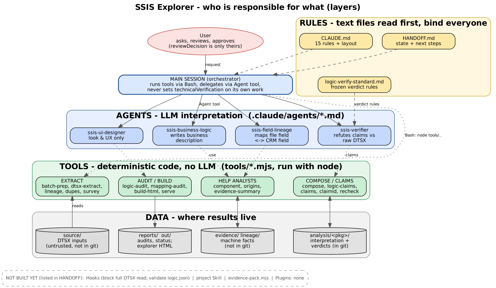
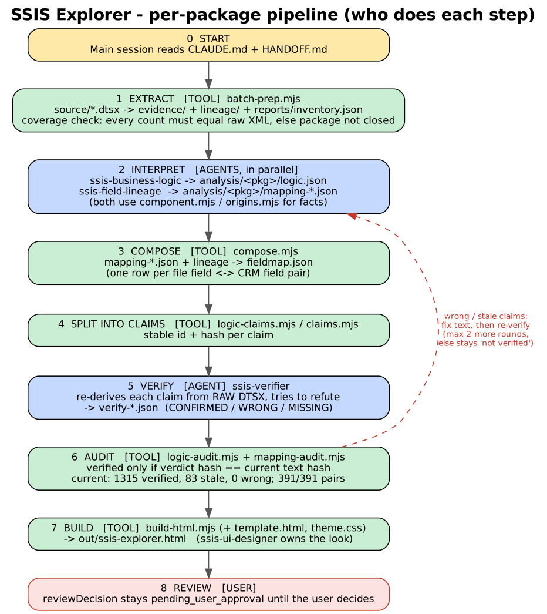

# SSIS Explorer – ארכיטקטורת הרכיבים

שני דיאגרמות (GraphViz, מרונדרות מקומית; שום תוכן לא נשלח לשירות חיצוני):

1. `ssis-explorer-layers` – מי אחראי על מה (שכבות).
2. `ssis-explorer-flow` – הזרימה לכל חבילה, שלב אחר שלב.

## טבלת אחריות: פעולה → רכיב

| פעולה | סוג הרכיב | הרכיב | איך הוא נקרא |
|---|---|---|---|
| קביעת כללי העבודה (דיוק, אין התאמת שמות, מקומי בלבד) | **חוק** | `CLAUDE.md` | נטען אוטומטית בתחילת כל סשן |
| מצב נוכחי והמשך | **חוק/מסמך** | `HANDOFF.md` | ש-CLAUDE.md מפנה אליו, נקרא ידנית |
| תקן אימות טענות | **חוק** | `reports/logic-verify-standard.md` | הבודק קורא אותו |
| חילוץ DTSX ← evidence, שושלת, כיסוי | **כלי (קוד)** | `batch-prep.mjs` (קורא ל-`dtsx-extract`, `lineage`, `dupes`, `survey`) | `node tools/batch-prep.mjs` ב-Bash |
| תיאור עסקי בעברית | **סוכן** | `ssis-business-logic` | המשימה מועברת אליו דרך כלי Agent |
| מיפוי שדה בקובץ ↔ שדה ב-CRM | **סוכן** | `ssis-field-lineage` | דרך כלי Agent |
| עזרי חקירה לסוכנים | **כלי** | `component.mjs`, `origins.mjs`, `evidence-summary.mjs` | הסוכנים מריצים ב-Bash |
| הרכבת המיפוי הסופי | **כלי** | `compose.mjs` | `node tools/compose.mjs <pkg>` |
| פירוק לטענות עם מזהה ו-hash | **כלי** | `logic-claims.mjs`, `claims.mjs`, `claimid.mjs`, `recheck.mjs` | Bash |
| ניסיון הפרכה של הטענות מול ה-DTSX הגולמי | **סוכן** | `ssis-verifier` | דרך כלי Agent |
| ספירת מאומת / ישן / שגוי | **כלי** | `logic-audit.mjs`, `mapping-audit.mjs` | Bash |
| בניית ה-HTML | **כלי** | `build-html.mjs` + `template.html` + `theme.css` | Bash |
| עיצוב ו-UX של הסייר | **סוכן** | `ssis-ui-designer` | דרך כלי Agent |
| הצגה בדפדפן | **כלי** | `serve.mjs` (הגדרת `explorer` ב-`.claude/launch.json`, פורט 8765) | הרצה מקומית |
| אישור סופי | **משתמש** | `reviewDecision` | Claude קובע רק `technicalVerification` |

## מה **אין** כרגע בפרויקט
- **Hooks:** אין `.claude/settings*.json`. מתוכננים (ב-HANDOFF): חסימת קריאה מלאה של `source/*.dtsx`, ובדיקת `logic.json` אחרי עריכה.
- **Skills של הפרויקט:** אין. מתוכנן skill קבוע לבודק ולמתקן.
- **Plugins:** אין בפרויקט. (ה-skill של הדיאגרמות הוא חלק מהסביבה שלך, לא של הריפו.)
- `evidence-pack.mjs`: מתוכנן, עוד לא נכתב.

## הנחות והערות
- המחלקה "Agent tool" ו-"Bash" הן יכולות של Claude Code, לא רכיבים של הפרויקט.
- התיאור של סדר השלבים מבוסס על כותרות הכלים, על הגדרות הסוכנים ועל HANDOFF.md. לא עקבתי אחרי קריאות בפועל בין הסוכנים.
- התוויות בדיאגרמות באנגלית, כי רינדור עברית ב-GraphViz מקומי חשוף לבעיות כיווניות בגופנים.

## גרסה בעברית וצבעונית
`ssis-explorer-architecture-he.html` (SVG מוטבע, RTL) ו-`ssis-explorer-architecture-he.png`. ירוק = כלי דטרמיניסטי, סגול = סוכן, כתום = משתמש, צהוב = חוקים, אדום מקווקו = לולאת תיקון ובדיקה חוזרת.
